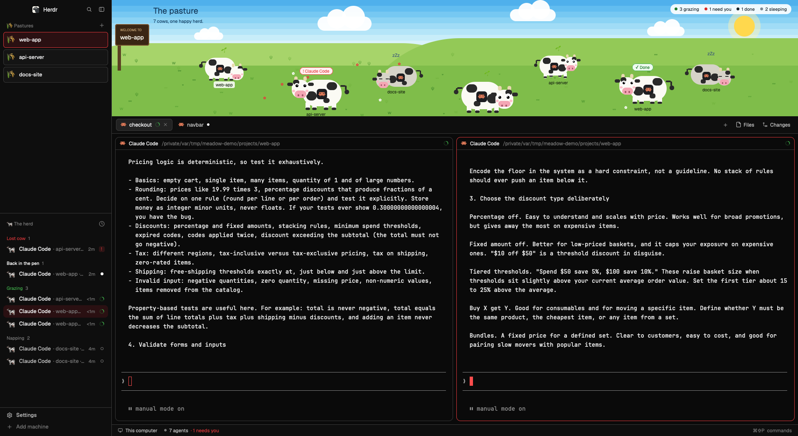

# 🐮 Meadow for Herdr 

A layout for the [Herdr](https://herdr.dev) desktop app that turns your agents into a herd of cows. See at a glance who needs you, who has finished and who is still working.



## Install

- You need the Herdr desktop app installed on your computer. If you don't have it yet, download it from [herdr.dev](https://herdr.dev).

- Paste to your coding agent:

```text
Install the Meadow layout for the Herdr desktop app from https://github.com/thangbuiq/herdr-layout-meadow: clone it to a temp folder,
then copy its layouts/, themes/ and mods/ contents into the Herdr folder ($HERDR_APP_HOME, else $XDG_CONFIG_HOME/herdr-app, else ~/.config/herdr-app),
first prompt me want to back up any files, then it would replace to .meadow-backups/<timestamp>/ there.
Run `herdr-app check` on each mod (~/.local/bin/herdr-app if not on PATH), then `herdr-app do layout.switch --name meadow`;
if Herdr is closed, tell me to open it and pick Meadow in Settings > Look. Delete the temp folder and report the result.
```

To remove Meadow, ask your agent (launch in herdr-app) and ask it to delete the files above and restore the backup.

## Reading the herd


| Agent status | The cow | Bubble | Counted as |
|---|---|---|---|
| Blocked | Hops on the spot, tail going fast | Red `! Agent name` | need you |
| Done | Bounces gently | Green `Done` | done |
| Working | Walks, or stops to graze and chew | Sprout | grazing |
| Idle | Lies down and stays still | `zzz` | sleeping |

Click a cow to jump to that agent.

## Light and dark

Meadow follows **Settings > Look > Appearance**. Choose Light, Dark or System and the window changes theme. The pasture looks the same in both.


## Credits

`mods/meadow-spaces`, `mods/meadow-agents` and `layouts/meadow.json` are modified from [Herdr](https://github.com/herdrdev/herdr-app) (Apache-2.0).
