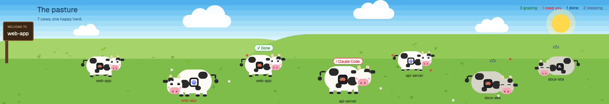
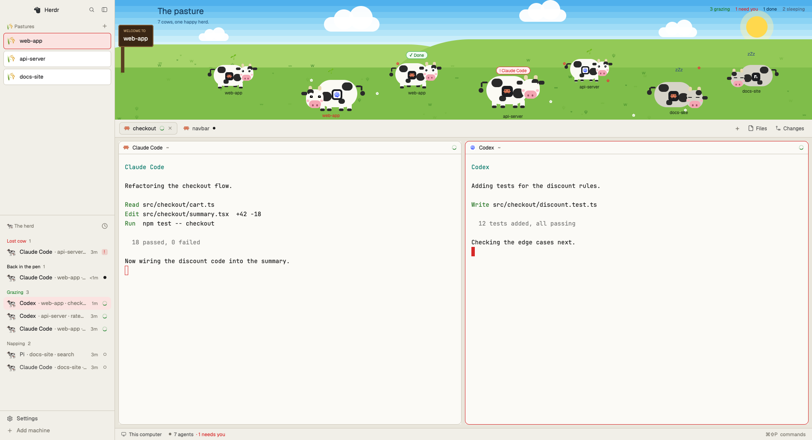

# Meadow for Herdr

A layout for the [Herdr](https://herdr.dev) desktop app that turns your agents into a herd of cows. See at a glance who needs you, who has finished and who is still working.


## Features

- **A live pasture:** every agent is a cow, with its program's badge and its space's name.
- **Status you can read from across the room:** a cow's pose and bubble show its state, and the counts sit at the top right.
- **Light and dark:** one layout that follows Herdr's appearance setting.
- **Spaces as pens:** the sidebar lists each space as a pen, and each agent by name under "The herd".
- **Light on battery:** cows are animated natively, with one slow timer to pick their next step.

## Reading the herd



| Agent status | The cow | Bubble | Counted as |
|---|---|---|---|
| Blocked | Hops on the spot, tail going fast | Red `! Agent name` | need you |
| Done | Bounces gently | Green `Done` | done |
| Working | Walks, or stops to graze and chew | Sprout | grazing |
| Idle | Lies down and stays still | `zzz` | sleeping |

Click a cow to jump to that agent.

## Light and dark

Meadow follows **Settings > Look > Appearance**. Choose Light, Dark or System and the window changes theme. The pasture looks the same in both.



## Install

You need the Herdr desktop app. Meadow is built and tested on `herdr-app` 0.1.11.

```sh
git clone https://github.com/thangbuiq/herdr-layout-meadow.git
cd herdr-layout-meadow
```

Then run the setup command for your system. Herdr can be open or closed.

| System | Command |
|---|---|
| macOS, Linux | `sh setup.sh` |
| Windows | `.\setup.cmd` |

The setup command:

1. Copies any earlier Meadow files to `.meadow-backups/<time>/` in your Herdr folder.
2. Copies in the layout, themes, preview image and mods.
3. Runs `herdr-app check` on each mod.
4. Switches the open window to Meadow. If Herdr is closed, open it and pick Meadow in **Settings > Look**.

It only touches its own files. Your other layouts, `keys.json` and `settings.json` stay as they are.

### Options

| macOS, Linux | Windows | What it does |
|---|---|---|
| `sh setup.sh --no-switch` | `.\setup.cmd -NoSwitch` | Installs without changing the layout on screen |
| `sh setup.sh --uninstall` | `.\setup.cmd -Uninstall` | Backs up, switches to `main`, then removes Meadow |

### Where it installs

The first of these that applies, on every system:

1. `HERDR_APP_HOME`, if set
2. `XDG_CONFIG_HOME/herdr-app`, if set
3. `~/.config/herdr-app`

### Manual install

Copy these into your Herdr folder, keeping the same paths, then run `herdr-app do layout.switch --name meadow`:

```
layouts/meadow.json
layouts/meadow.svg
themes/meadow-dark.json
themes/meadow-light.json
mods/meadow-field/
mods/meadow-spaces/
mods/meadow-agents/
```

## Usage

- **Switch layouts:** press `ctrl-shift-l`, or open **Settings > Look**.
- **Change appearance:** open **Settings > Look > Appearance**.
- **Get out of trouble:** `ctrl-alt-shift-escape` always returns to Herdr's default layout.

## Customizing

| To change | Edit |
|---|---|
| Colors | `themes/meadow-dark.json`, `themes/meadow-light.json` |
| The pasture and cows | `mods/meadow-field/main.js` |
| Pasture height | The `field` block's `size` in `layouts/meadow.json`, and `H` in `mods/meadow-field/main.js` |
| Settings preview | `scripts/generate-preview.py`, then `python3 scripts/generate-preview.py layouts/meadow.svg` |

Run `herdr-app check <mod folder>` after changing a mod. Herdr reloads saved files by itself.

## Troubleshooting

- **Terminal text is hard to read in Light:** set the program to its light theme. Claude Code has `/theme`.
- **Sidebar icons are missing on Linux:** they're emoji, so install an emoji font.
- **Cows change spots after a reload:** each cow picks a new starting spot when the mod reloads.
- **Restoring a backup:** copy the contents of `.meadow-backups/<time>/` back into your Herdr folder.

## Project layout

```
layouts/    the window, and its Settings preview
themes/     the dark and light palettes
mods/       the pasture (meadow-field), spaces and agents lists
scripts/    generates the Settings preview
docs/       the images on this page
setup.*     the setup commands
RECIPE.md   a brief for rebuilding Meadow from scratch
```

`meadow-spaces` and `meadow-agents` are modified clones of Herdr's own mods, so they don't pick up Herdr's later changes to those. They also use icons from Herdr's shipped `workspace-chrome` mod.

## License

[Apache License 2.0](LICENSE). See [NOTICE](NOTICE) for attribution.
