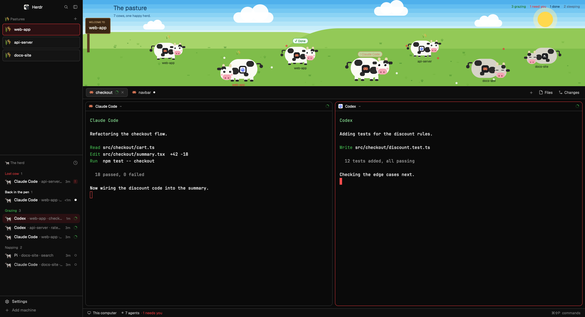

# Meadow

A Herdr layout where every agent is a cartoon cow on a sunny pasture above the tabs. A cow's pose and bubble show its agent's status. The window around the pasture follows the light or dark appearance.

## What you see

Left to right, then top to bottom:

- **Sidebar, 268px:** the shipped brand bar, then "Pastures", then "The herd", then the shipped footer.
  - **Pastures:** each space is a 38px pen with a 6px radius, a 1.5px border and a 🌾 icon. The active pen has an `accent` border and a `selected` fill.
  - **The herd:** each row has a 🐄, the agent's program name ("Claude Code"), then its space and any named tab in `dim`. Sections are "Lost cow", "Back in the pen", "Grazing" and "Napping".
- **Pasture, 280px tall, full width of the work column:**
  - Sky: eight bands from `#4fb0ec` to `#d9f3fa`, white clouds, and a `#ffd84d` sun with a pale halo.
  - Hills: three large ellipses in `#a7d46a`, `#93c957` and `#7fbd4a`, with scattered grass tufts and white and red flowers.
  - Top left: a brown "WELCOME TO <active space>" sign, the title "The pasture", and "N cows, one happy herd."
  - Top right: a white chip with a colored dot and dark text for each count: grazing, need you, done and sleeping.
  - Cows: `#fbfaf4` hide with `#2a2a2a` patches, drawn from rounded boxes. Each has beige horns, big white eyes with black pupils and a white glint, pink cheeks and muzzle, four stubby legs, a short tail with a round tip, and a badge with its program's tile and icon. Below is the space name, on a white chip for the focused agent. The pasture looks the same in both appearances.
- **Below the pasture:** the shipped tab bar, panes as cards with `pane` headers, Files and Changes panels, and the status bar.

Themes: `meadow-dark` is black with white text and a `#e5383b` accent. `meadow-light` is `#fbfaf6` with `#1a1a1a` text and a `#d62828` accent. Both use green for `working`.

## How it behaves

| Status | Cow | Bubble | Walks |
|---|---|---|---|
| `blocked` | Hops 7 units every 420 ms, fast tail | Red pulsing `! <program>` | At 60% |
| `done` | Bounces gently | Green `✓ Done` | At 60% |
| `working` | Walking: head up, legs tap. Stopped: head down and chewing | Flickering sprout | Fully |
| `idle` | Lies down with no legs, closed eyes and low ears, breathes slowly, slow tail | Drifting `zzz` | Never |

- **Walking:** every 6 seconds each awake cow has a 70% chance of taking a step. Its heading turns a little each step and is pushed off the straight axes, so paths are always slanted. It stays inside the field and turns back at the edges.
- **Facing:** the drawing mirrors to face the way the cow walks.
- **Falling asleep mid-walk:** the cow stops where it is.
- **Size:** each cow keeps the size it was given on arrival. Nearer cows are bigger.
- **Clicks:** a cow or herd row runs `pane.focus`. Pens select their space.

## Built from

- **Layout:** `layouts/meadow.json`, cloned from `main`. Root `theme` is `{ "light": "meadow-light", "dark": "meadow-dark" }`. The `work` column starts with a `field` block of 280px holding `meadow-field`. The `spaces` and `agents` blocks use `meadow-spaces` and `meadow-agents`.
- **Shipped mods:** `workspace-chrome`, `tabs`, `pane`, `files`, `changes`, `workspace-status`, `menu`.
- **Herdr functions:** `agents`, `spaces`, `theme`, `run`, plus what the two cloned mods already use.
- **Motion:** `.loop` for bounce, head, chewing, ears, tail tip, legs and breathing. `.frames` for blinks, sprouts and `zzz`. `.transition("left" | "top")` for walking. One `cx.timer.every(6000)` picks the next step.
- **Art:** rounded `div`s only, no image files. `layouts/meadow.svg` is the Settings preview, made by `scripts/generate-preview.py`.

## Watch out

- `.transition("left")` doesn't glide between percentages: the element jumps. Read the width with `.on_size_change` and position in pixels.
- Don't derive a cow's scale from its live depth. The size pops at every step, because sizes aren't transitioned.
- Keep the walk's transition duration equal to the timer's interval, with linear easing, or cows pause between steps.
- Legs are drawn behind the body, so keep them long enough to show below the belly. A long stride looked wrong: a short vertical tap reads best.
- Don't use a fast timer for animation. Every redraw repaints the whole window.
- `.bg()` takes a color, not a gradient object. The sky is stacked bands.
- Theme colors in the layout must be names, like `chrome`, so they work in both appearances.
- Cows can overlap for a moment. Nothing keeps them apart.

## Done when

- `herdr-app check` passes for all three mods, and `herdr-app status` lists no errors.
- With an agent in each status, the counts match and each cow shows the pose and bubble above.
- Changing **Settings > Look > Appearance** switches the sidebar, panes and terminals between the two themes, with no layout change.
- Samples of a walking cow's position taken 0.8 seconds apart advance evenly, with no jumps.
- A sleeping cow stays in exactly the same place across screenshots.
- Settings > Look shows the preview on the Meadow card.
